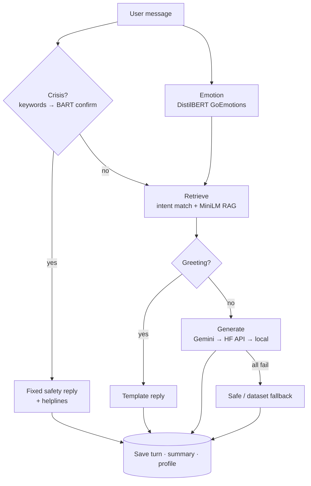

<div align="center">

# 🧠 MindCare

**An empathetic mental-health support companion with a safety-first pipeline.**
Emotion detection · crisis gating · retrieval-augmented replies · persistent memory


</div>

> ⚠️ **MindCare is a supportive companion, not professional care.** It is not a diagnostic tool and has not been clinically validated.
> India helplines: **1860 266 2345** / **9152987821**. If someone is in immediate danger, contact local emergency services.

---

## ✨ Features

- **Safety first** – a deterministic crisis path (keyword gate confirmed by zero-shot BART) that bypasses the LLM and returns a fixed helpline reply.
- **Emotion-aware** – 28-label GoEmotions classifier runs locally on every message.
- **Grounded replies** – ~85 curated intents plus ~2,500 counseling pairs retrieved with MiniLM sentence embeddings; retrieval only *informs* the prompt and is never dumped raw at the user.
- **Memory that feels continuous** – per-conversation history, rolling summaries, and a structured profile (concerns, triggers, what helped), stored in Redis with an automatic in-memory fallback.
- **ChatGPT-style web UI** – multiple titled conversations, auto-titling, calm custom design (vanilla HTML/CSS/JS, no build step).
- **Pluggable generation** – Gemini (default) → Hugging Face Inference API → local weights, with optional failover.
- **Built-in evaluation** – golden-case suites for emotion, crisis, RAG, routing and memory.

## 🏗️ How a reply is chosen



| Priority | When | `reply_source` |
|---|---|---|
| 1. Crisis | Clear self-harm / suicide-risk language | `crisis: true` |
| 2. Template | Short greetings only | `template` |
| 3. Generation | Everything else | `gemini` / `hf_api` / `local` |
| 4. Fallback | All generators fail | `safe_fallback` / `dataset_fallback` |

Templates are greetings-only so that sadness, breakups, burnout etc. get natural, context-aware replies from the generator.

## 🧰 Tech stack

| Layer | Technology |
|---|---|
| Emotion | [`joeddav/distilbert-base-uncased-go-emotions-student`](https://huggingface.co/joeddav/distilbert-base-uncased-go-emotions-student) |
| Crisis | Regex gate + [`facebook/bart-large-mnli`](https://huggingface.co/facebook/bart-large-mnli) |
| Retrieval | [`sentence-transformers/all-MiniLM-L6-v2`](https://huggingface.co/sentence-transformers/all-MiniLM-L6-v2), cosine similarity |
| Generation | Google Gemini Flash · HF Inference API · local HF |
| Memory | Redis (in-memory fallback) |
| Backend / UI | Flask + flask-cors · vanilla JS frontend |

## 🚀 Quick start

```bash
git clone https://github.com/aikansh-dua/MindCare.git
cd MindCare
python3 -m venv .venv && source .venv/bin/activate
pip install -r requirements.txt

# Build the RAG corpus + embedding cache (git-ignored, required for retrieval)
python expand_dataset.py

cp .env.example .env     # then set GEMINI_API_KEY (free: https://aistudio.google.com/apikey)
./run.sh ui              # → http://127.0.0.1:5050
```

Optional: `brew services start redis` (or `./run.sh redis`) for persistent memory. Without Redis, memory lives in-process and resets on restart. The first chat is slow while Hugging Face models download and load.

### Generation providers

Set `GENERATION_PROVIDER` in `.env`:

| Provider | Config | Notes |
|---|---|---|
| `gemini` (default) | `GEMINI_API_KEY`, `GEMINI_MODEL=gemini-flash-lite-latest` | Flash models only; other names fall back to the default. Fails fast on timeout. |
| `hf_api` | `HF_TOKEN`, `HF_CHAT_MODEL` | No local GPU needed. |
| `local` | `CHATBOT_MODEL`, `CHATBOT_FALLBACK_MODEL` | 7B model needs lots of RAM. |

Set `GENERATION_FAILOVER=true` to try the next provider when one fails. All options are documented in [`.env.example`](.env.example).

## 🔌 API

| Method | Path | Purpose |
|---|---|---|
| `GET` | `/` | Web UI |
| `GET` | `/health` | Status, memory backend, generation config |
| `POST` | `/chat` | One chat turn |
| `GET` `POST` | `/conversations` | List / create conversations for an owner |
| `GET` `DELETE` | `/conversations/<id>` | Fetch / delete a conversation |
| `POST` | `/conversations/<id>/title` | LLM-polished title |
| `GET` | `/chat_memory` | History + summary |
| `GET` | `/user_profile` | Structured profile |
| `POST` | `/clear` | Clear a conversation |

```bash
curl -s -X POST http://127.0.0.1:5050/chat \
  -H 'Content-Type: application/json' \
  -d '{"owner_id":"demo","message":"I feel overwhelmed at work and do not know where to start"}'
```

```jsonc
{
  "response": "...",
  "emotion": "nervousness",
  "crisis": false,
  "reply_source": "gemini",
  "rag_hits": 1,
  "intent": "stressed",
  "memory_backend": "redis",
  "conversation_id": "...",
  "generation": { "provider": "gemini", "...": "..." }
}
```

## ✅ Evaluation

Golden cases live in [`eval_cases.json`](eval_cases.json).

```bash
./run.sh eval                  # full suite (generation stubbed)
./run.sh eval --quick          # project + rag + crisis
./run.sh eval --suite rag,chat
./run.sh eval --live           # + real Gemini / HF smoke test
```

Suites: **project · emotion · crisis · rag · chat · memory · live**.

## 📁 Project structure

```
MindCare/
├── app.py                 Flask app: web UI + API
├── chatbot.py             Pipeline orchestration
├── emotion.py             Emotion classifier
├── crisis.py              Crisis gate (keywords + BART)
├── rag.py                 Embedding retrieval + cache
├── generation.py          Gemini / HF API / local, failover
├── memory.py              Redis history, summaries, profiles, conversations
├── expand_dataset.py      Build intents + RAG corpus + embeddings
├── evaluate.py            Evaluation harness  (fixtures: eval_cases.json)
├── frontend/              index.html · styles.css · app.js
├── mindcare_dataset.json  Intent knowledge base
├── run.sh                 ui | streamlit | eval | redis
├── bot.py                 Legacy Streamlit UI
├── main.py, llm_providers.py   Legacy FastAPI path (Vercel)
├── CONTEXT.md             Architecture & design-decision reference
└── .env.example
```

See [CONTEXT.md](CONTEXT.md) for a deeper architecture walkthrough and known caveats.

## 🔒 Privacy & limitations

- There is **no authentication**; `owner_id` is client-supplied. Don't expose a deployment publicly without adding auth.
- Conversations are stored in plain text in Redis, with no expiry by default (`MEMORY_TTL_SECONDS=0`).
- Crisis detection is keyword-driven and can miss indirect phrasing.
- Generated replies come from an LLM and can be wrong or unhelpful.

## 🗺️ Roadmap

- Authentication and per-user data isolation
- Streaming responses
- Broader multilingual / Hinglish crisis coverage
- Retire the legacy FastAPI/Streamlit entry points

## 📚 Data & licensing

Intents derive from a public mental-health chatbot dataset, expanded with career, academic, burnout and loneliness intents. The RAG corpus comes from public counseling conversations (Amod dataset). Respect upstream dataset licenses if you redistribute the JSON files.

No code license has been chosen yet; all rights reserved by the author until one is added.
